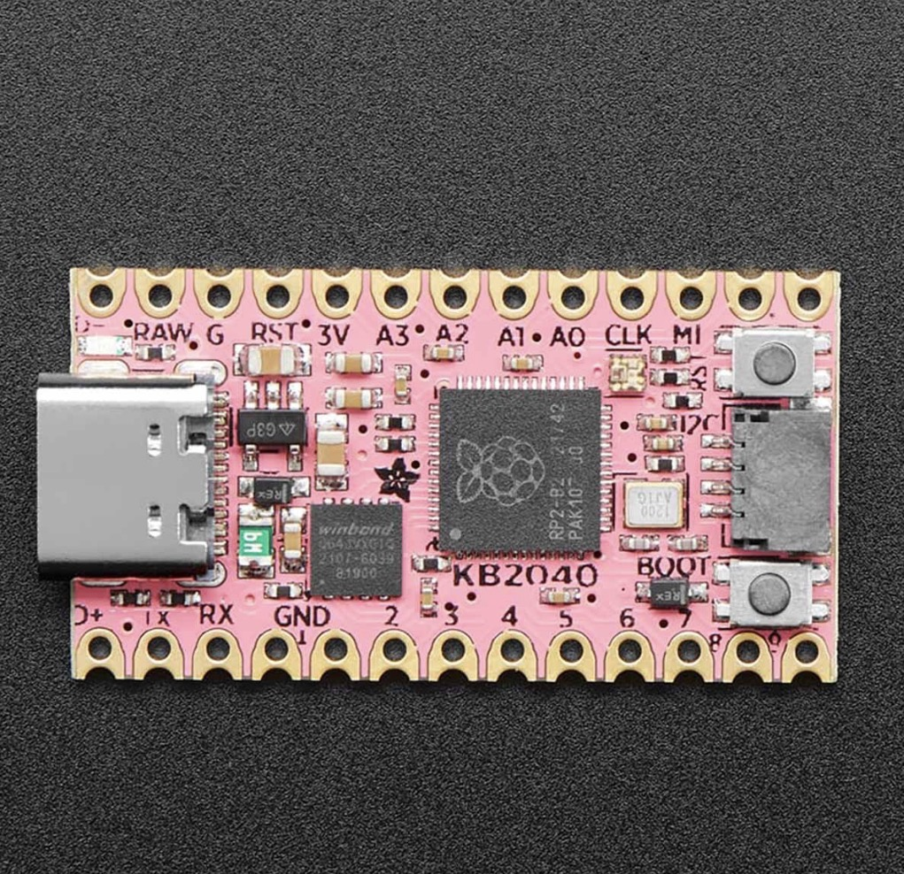

# Mini-MIDI

A handheld USB MIDI controller for practicing DJ mixes on the go. The prototype uses an **Adafruit KB2040** running CircuitPython, three potentiometers, and four physical switches (the EQ selector uses two inputs). It sends controls to DJ software; it does not generate or mix audio itself.



## Firmware

- [`firmware/code.py`](firmware/code.py) + [`firmware/midi_logic.py`](firmware/midi_logic.py): revision 2, with switch debounce, separate pot calibration ranges and no filter-switch reboot. **Hardware validation pending.**
- [`code revision 1`](code%20revision%201) and [`proto1 code`](proto1%20code): original snapshots, retained for comparison.

Install both revision 2 files at the root of `CIRCUITPY`, not inside a `firmware` folder. See the [setup and bench checklist](docs/SETUP.md).

## Controls

All messages are Control Change on **MIDI channel 1** (`out_channel=0` in the library). These are project assignments; map them manually in your DJ application.

| Mode / control | Deck A pot (A0) | Deck B pot (A1) |
| --- | --- | --- |
| D5 on: split mode, highest priority | CC 14, volume | CC 11, filter |
| D5 off, D2 on: filter mode | CC 10, filter | CC 11, filter |
| Both off, EQ high | CC 1 | CC 2 |
| Both off, EQ mid | CC 3 | CC 4 |
| Both off, EQ low | CC 5 | CC 6 |

A2 always sends CC 9 (crossfader). D6 sends CC 13 with 127 for on and 0 for off. Pot values span 0–127. Switching modes immediately sends the pot's current value to the new CC, so software parameters can jump; pickup/soft takeover is future work.

## Build and development

- [Wiring and candidate parts suppliers](docs/HARDWARE.md)
- [Installation, calibration and hardware checks](docs/SETUP.md)
- [Primary technical resources](docs/RESOURCES.md)
- CAD: `Part Studio 1 - Part 1.zip` is an early enclosure concept. Check component dimensions before revising or printing it.

Run desktop logic tests with Python 3:

```sh
python -m unittest discover -s tests -v
python -m py_compile firmware/code.py firmware/midi_logic.py
```

These checks cover routing, deadband and switch debounce. They do not verify USB enumeration, ADC noise, physical wiring or real latency.
