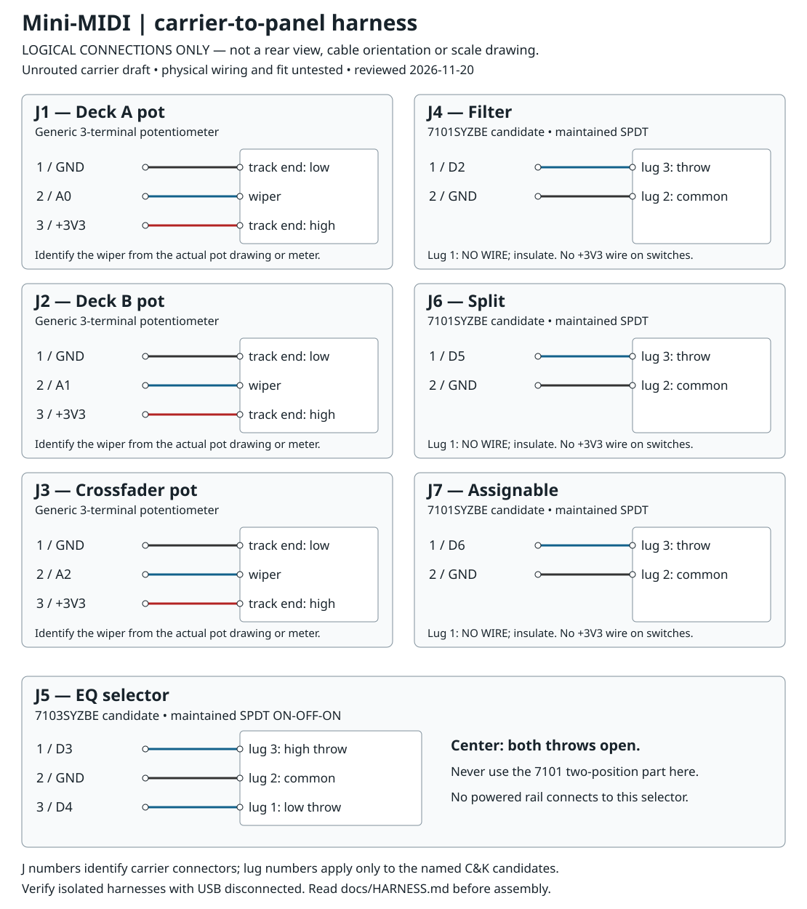

# Carrier-to-panel harness guide

Reviewed **2026-11-20**. This guide explains the intended revision-A carrier connections, not an as-built harness. The PCB remains unrouted; its connector pin assignments do not establish electrical continuity on a manufactured board. Keep the KB2040, A0/A1/A2 controls and D2–D6 switch functions unchanged.

The [editable SVG](images/carrier-harness.svg) is a logical connection diagram. It is not a physical terminal rear view, cable assembly drawing, board footprint or enclosure layout. Wire colors are illustrative; follow the labels. Pin 1 is the numbered **carrier connector contact**, not “the left wire” of a housing viewed from an unspecified side.

## Terminate each harness

| Carrier | Function | Panel termination |
| --- | --- | --- |
| J1.1 / J1.2 / J1.3 | GND / A0 / +3V3 | Deck A pot: low track end / wiper / high track end |
| J2.1 / J2.2 / J2.3 | GND / A1 / +3V3 | Deck B pot: low track end / wiper / high track end |
| J3.1 / J3.2 / J3.3 | GND / A2 / +3V3 | Crossfader pot: low track end / wiper / high track end |
| J4.1 / J4.2 | D2 / GND | Filter switch signal / common |
| J6.1 / J6.2 | D5 / GND | Split switch signal / common |
| J7.1 / J7.2 | D6 / GND | Assignable switch signal / common |
| J5.1 / J5.2 / J5.3 | D3 / GND / D4 | EQ high throw / common / low throw |

“Low/high track end” means low/high ADC output at that stop, not a clockwise promise. Identify the actual pot wiper from its datasheet or resistance measurements; outer-terminal numbering is not universal. Swap only the two track ends if the required physical direction is reversed.

For the [7101SYZBE on/off candidate](HARDWARE.md#specific-onoff-toggle-candidate), common is lug 2, signal uses lug 3, and lug 1 has no wire and must be insulated. For the [7103SYZBE EQ candidate](HARDWARE.md#specific-eq-selector-candidate), common is lug 2, D3 uses lug 3 and D4 uses lug 1. These are different switching functions despite similar bodies. Do not apply their lug numbers to another switch model.

## Check isolated harnesses before power

Disconnect USB and any other power. Unplug the harness from the carrier while identifying terminals; module circuits, shared grounds and other controls can otherwise create misleading meter paths. Inspect every joint for stray strands and exposed unused lugs. Cable housings, crimp contacts/tooling, wire gauge/length, strain relief and service-loop lengths are still unselected; this guide does not approve a finished cable assembly.

1. Label each cable at both ends with its J reference and identify pin 1 from the actual connector drawing/PCB numbering. Unkeyed headers permit reversal and one-pin offsets.
2. For each pot, verify that the two outer track connections retain the pot's end-to-end resistance and the wiper resistance changes toward each end as the shaft turns. The track is resistive: do not interpret its ordinary end-to-end resistance as a short or expect a continuity beep. Confirm there is no unintended direct +3V3-to-GND wire connection.
3. For each on/off harness, verify signal-to-GND closes in the intended on position and opens in off. With the 7101 candidate, check that lug 1 has no external wire and cannot touch adjacent metal. Its internal connection to common in off is normal; insulation prevents unintended external contact.
4. For the EQ harness, verify D3-to-GND closes only in high, both contacts open in mid, and D4-to-GND closes only in low. Do not rely on the firmware's both-grounded fallback to hide a wiring fault.
5. Reconnect only after the harness mapping is confirmed. Use the [temporary diagnostic](../tools/README.md) for raw input checks, then restore the controller and follow the [bench checklist](SETUP.md#bench-checklist--pending-physical-execution). Record actual observations separately; none of these checks have been executed on the prototype here.

## Sources and verification limits

The connector net mapping comes from the committed [native schematic](../hardware/pcb/rev-a/mini-midi-carrier.kicad_sch), [pin contract](../hardware/pcb/DESIGN_NOTES.md) and current `firmware/code.py`, reviewed 2026-11-20. All 18 diagram connector contacts were compared with a freshly exported schematic netlist on desktop. The SVG and guide add no native schematic/board or firmware change.

Candidate lug/function references: [official C&K/Littelfuse 7000-series datasheet](https://www.littelfuse.com/assetdocs/littelfuse-ck-toggle-7000-series-datasheet?assetguid=fed01bc6-88d0-4bda-b896-13c98cf9e90e), page 3, reviewed 2026-11-20. [Official KB2040 pinouts](https://learn.adafruit.com/adafruit-kb2040/pinouts) remain the board wiring reference. Installed part identities, continuity, ADC readings, harness retention and enclosure fit remain unverified. Candidate supplier/lifecycle/stock distinctions are recorded in the hardware guide.
