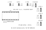

# Initial PCB model — revision A

**Schematic and component placement draft. UNROUTED. Not for fabrication.**

This first model keeps the KB2040 module and puts three analog-control connectors plus four switch connectors on a provisional 90 × 60mm two-layer carrier. It preserves the active firmware and MIDI mappings. Read the [architecture, pin contract, sources and assumptions](DESIGN_NOTES.md) before editing or connecting hardware.



The preview shows component pads and placement, not finished copper routing. Open the PCB in KiCad to see the unrouted connections.

## Open and edit

Open [mini-midi-carrier.kicad_pro](rev-a/mini-midi-carrier.kicad_pro) in **KiCad 9**. The project includes:

- [Native schematic](rev-a/mini-midi-carrier.kicad_sch) and [schematic preview](rev-a/previews/mini-midi-carrier.svg).
- [Native PCB](rev-a/mini-midi-carrier.kicad_pcb), local symbols and a socketed-module footprint with project-local library tables.
- [Auditable module pad map](rev-a/module-pin-map.json), original/source header IDs and coordinates.
- [Connectivity checker](rev-a/check_connectivity.py) and [recorded check reports](rev-a/checks/).

The module symbol abstracts the purchased board as passive connection pins. ERC does not analyze the module's internal regulator, USB circuit or RP2040. Carrier pad numbering is defined in the design notes and is not a physical KB2040 silkscreen numbering scheme.

## Checks recorded on 2026-11-14

| Check | Result | What it establishes |
| --- | --- | --- |
| Schematic ERC, KiCad 9.0.2 | 0 violations | Connected labels, no-connect flags and library references pass this model's rules |
| PCB DRC | 0 geometry violations; **20 unconnected items** | Placement is free of reported geometry violations; routing is incomplete |
| Schematic/PCB parity | 0 issues | Symbol references, footprints and pad nets correspond |
| Independent connectivity audit | Pass | All 26 module pad centers, 8 firmware assignments and 24 net membership sets match |
| Physical test / enclosure fit | Not performed | No fabrication or fit readiness claim |

Do not interpret the geometry result as a completed DRC pass: the 20 unrouted connections remain blockers. No Gerbers or drill package has been released.

## Recheck after edits

From the repository root:

```sh
kicad-cli sch erc --format json --units mm -o hardware/pcb/rev-a/checks/erc.json hardware/pcb/rev-a/mini-midi-carrier.kicad_sch
kicad-cli pcb drc --schematic-parity --format json --units mm -o hardware/pcb/rev-a/checks/drc.json hardware/pcb/rev-a/mini-midi-carrier.kicad_pcb
python3 hardware/pcb/rev-a/check_connectivity.py
```

Use the Python interpreter supplied with KiCad or one with `pcbnew` installed (the recorded audit used `/usr/bin/python3`). The audit generates a fresh temporary schematic netlist; it checks logical membership, not trace completion. Mismatches exit nonzero even under `python3 -O`; validation uses explicit checks rather than removable assertions. `--project-dir` and `--repo-root` let regression tests check temporary copies without touching the working design. Inspect report contents: the CLI commands above can produce reports while returning success even with reported violations.

## Before routing and fabrication

1. Confirm the actual KB2040 revision, socket geometry and header stack height with a 1:1 print and samples.
2. Establish enclosure internal clearance, USB plug space and mounting points; revise the provisional outline.
3. Finalize exact harness connectors and orientation labels. Confirm every control against the existing wiring table.
4. Route all nets on F.Cu/B.Cu, provide ground distribution and review return paths. Assess optional filtering using measured analog noise.
5. Run ERC, DRC including unconnected items and schematic parity again. Review clearances, fabrication rules, silkscreen, actual part drawings and assembly access before generating manufacturing outputs.

No boards or parts have been ordered, and the active firmware has not been modified by this contribution.

## Audit regression checks

With KiCad's Python interpreter, run from the repository root:

```sh
python3 -m unittest discover -s tests -p test_pcb_audit.py -v
```

These integration tests accept the current design and deliberately corrupt a copied module coordinate and firmware pin assignment. Both mismatches must fail in normal and optimized Python modes. Without `pcbnew` or `kicad-cli`, these tests are skipped; a skipped test is not PCB validation.

Reviewed 2026-11-15: [Python assertion behavior](https://docs.python.org/3/reference/simple_stmts.html#the-assert-statement) explains why `assert` is unsuitable as a mandatory audit check when optimized mode is permitted. KiCad check commands are documented in the [official CLI reference](https://docs.kicad.org/9.0/en/cli/cli.html).
